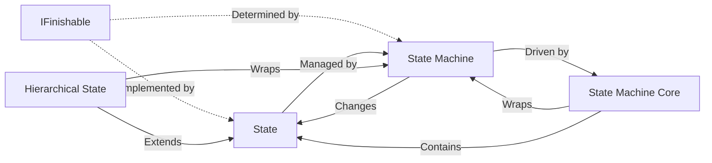
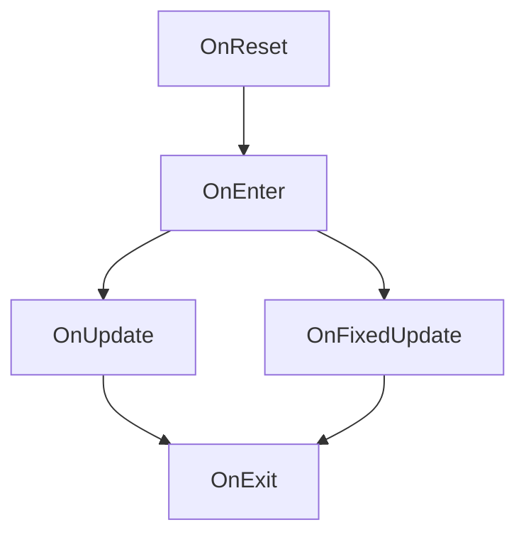

# State Machine System

A framework for implementing state-driven behaviours.

---

## Features

- Event-driven architecture
- Context-based states
- Custom `State` creation
- Timed states
- Hierarchical states
- Custom `StateMachine` implementations
- Custom `StateMachineCore` integration

---

## Diagrams

### System Architecture



---

### Life Cycle Order



---

## Quick Start

### Create Custom State

```csharp
public sealed class WalkState : State
{
    public WalkState(StateName name) : base(name) { }
    public WalkState() : base() { }

    // Calls before OnEnter
    protected override void OnReset() 
    {
        Debug.Log("Walk State was reset.");
    }

    // Calls when it is set as the new current state.
    protected override void OnEnter()
    {
        Debug.Log("Started walking.");
    }

    // Calls per frame.
    protected override void OnUpdate(float deltaTime)
    {
        Debug.Log("Walking.");
    }

    // Calls per fixed interval.
    protected override void OnFixedUpdate(float fixedDeltaTime)
    {
        Debug.Log("Applying walking physics.");
    }

    // Calls when it is no longer the current state.
    // Calls when it is set as the new previous state.
    protected override void OnExit()
    {
        Debug.Log("Stopped Walking.");
    }
}
```

---

### Create Custom State Machine Core

```csharp
public sealed class WalkCore : StateMachineCore<TContext>
{
    [SerializeField] private Rigidbody2D m_rigidbody2D;

    // The given context for all of this core's states.
    protected override TContext Context => ...;

    // The immediate states used by the core.
    protected override IReadOnlyList<State> ConstructStates()
    {
        return new State[]
        {
            new State("Idle"),
            new WalkState("Walk")
        };
    }

    protected override void OnUpdate(float deltaTime)
    {
        bool isWalking = Mathf.Abs(m_rigidbody2D.linearVelocityX) > 0.01f;

        if (isWalking) ChangeState("Walk");
        else ChangeState("Idle");
    }
}
```

---

### Create Custom State (Finishable)

```csharp
// A state machine can only change out of this state if it is finished.
// You can do the following to force said change: ChangeState(..., true).
public sealed class FinishableState : State, IFinishable
{
    private bool _isFinished;
    public bool IsFinished => _isFinished;
    void IFinishable.SetIsFinished(bool isFinished) => _isFinished = isFinished;

    public FinishableState(StateName name) : base(name) { }
    public FinishableState() : base() { }

    ...
}
```

---

## Requirements

- Unity 6000.3+
